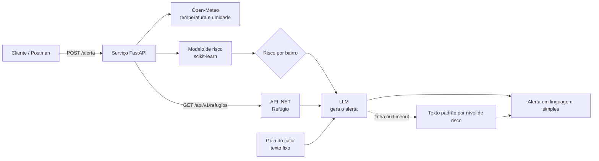

# Refúgio IA — alertas de onda de calor para idosos

Global Solution 2026/2 · CitizenTech · FIAP · Disruptive Architectures: IoT, IoB & Generative IA

## Integrantes

| Nome | RM |
|---|---|
| Anna Clara Russo Luca | 561928 |
| Gabriel Duarte Maciel | 565754 |
| Tiago Guedes da Costa | 564731 |
| Gustavo Tavares da Silva | 562827 |

---

## O que é

O **Refúgio** é uma solução para proteger idosos durante ondas de calor. Prédios públicos e locais da comunidade (bibliotecas, UBSs, centros comunitários) funcionam como **refúgios climáticos**: o idoso reserva uma vaga pelo app e mostra o comprovante na porta.

Este repositório é o **módulo de IA** do projeto. Ele é um serviço em Python que:

1. **Prevê o risco de calor por bairro** (baixo, médio ou alto) com um modelo de Machine Learning, a partir de temperatura, umidade e proporção de pessoas com 60 anos ou mais.
2. **Gera um alerta personalizado e acessível** com um LLM: frases curtas, linguagem simples, o refúgio aberto no bairro e o que fazer.

O módulo consulta a **API .NET do Refúgio** para saber quais refúgios estão ativos no bairro. O app mobile consome só a API .NET, e este serviço é independente dele.

**Cidadão beneficiado:** idosos, principalmente os que moram sozinhos.
**ODS:** 3 (Saúde e bem-estar), 11 (Cidades e comunidades sustentáveis) e 13 (Ação contra a mudança global do clima).

## Objetivo

Antecipar o risco de calor em cada bairro e transformar esse dado em uma mensagem que o idoso entenda e possa seguir, apontando um refúgio onde há vaga.

- **Dentro do escopo:** classificar o risco por bairro, escrever o alerta, citar só refúgios reais devolvidos pela API .NET e continuar respondendo quando o LLM ou a API falham.
- **Fora do escopo:** diagnóstico médico, previsão meteorológica própria e envio do alerta ao celular (push, SMS).

## Como funciona



1. O serviço obtém temperatura e umidade do bairro (Open-Meteo) ou usa os valores simulados enviados na requisição.
2. O modelo de ML classifica o risco com temperatura, umidade e % de idosos do bairro.
3. O serviço pede à API .NET os refúgios ativos no bairro.
4. O LLM recebe risco, números, refúgios e o Guia do calor, e escreve o alerta.
5. Se o LLM falhar, o serviço devolve um texto padrão para aquele nível de risco. O alerta nunca fica vazio.

**Dado pessoal:** nenhum dado do idoso (nome, telefone, contato de emergência) é enviado ao LLM. Ele recebe só bairro, risco, números do clima e nomes de refúgios.

## Tecnologias utilizadas

| Camada | Tecnologia | Para quê |
|---|---|---|
| Linguagem | Python 3.11+ | Todo o módulo de IA |
| API | FastAPI + Uvicorn | Endpoints `/alerta`, `/bairros`, `/health` e Swagger em `/docs` |
| Machine Learning | scikit-learn, pandas, joblib | Treino, avaliação e carga do classificador de risco |
| IA generativa | Ollama local com `llama3.1` (8B) | Redação do alerta, sem custo por chamada e sem dado saindo da máquina |
| Clima | Open-Meteo | Temperatura e umidade por latitude e longitude |
| Demografia | IBGE, Censo 2022 (agregados por distrito) | Proporção de população com 60 anos ou mais e centroide de cada bairro |
| Integração | httpx | Chamadas à API .NET do Refúgio |
| Testes | pytest | Testes do modelo, do serviço e dos cenários de falha |
| Configuração | python-dotenv | Variáveis de ambiente (`.env`, fora do Git) |

### Modelo de ML

- **Tipo:** classificação em 3 classes (baixo, médio, alto).
- **Bairro = distrito do IBGE.** São os 96 distritos da cidade de São Paulo, com os mesmos nomes do cadastro de refúgios da API .NET.
- **Entradas:** temperatura (°C), umidade relativa (%) e % da população com 60 anos ou mais. O clima é o da **pior hora do dia** (maior índice de calor), tanto no treino quanto em produção.
- **Dados:** 105.216 linhas (96 distritos × 1.096 dias, 2023 a 2025). Clima horário histórico do Open-Meteo (ERA5-Land) e % de 60+ do Censo 2022.
- **Rótulo (derivado):** índice de calor da NOAA da pior hora, somado a 0,2 °C por ponto percentual de idosos acima da média da cidade (17,66%), comparado com as faixas da NOAA: médio a partir de 26,7 °C, alto a partir de 32,2 °C.
- **Algoritmo:** **Random Forest** (servido), comparado com regressão logística e com um baseline por regra de temperatura do ar.
- **Validação:** treino em 2023–2024 e teste em 2025 (divisão por tempo). Hiperparâmetros da RF escolhidos por validação cruzada por ano.
- **Métricas no teste (macro-F1):** baseline 0,778 · regressão logística 0,957 · Random Forest 0,973. Matrizes de confusão em `models/metricas.json` e análise em `docs/avaliacao.md`.

### Limitações

- **O rótulo de risco é derivado, não observado.** Não existe dado público de risco de calor por bairro. O rótulo vem do índice de calor combinado com a proporção de idosos. O modelo aprende essa regra, então uma métrica alta não prova acerto no mundo real. O que as métricas medem aqui é a consistência com a regra.
- O modelo não leva em conta ilha de calor urbana, condições de moradia nem saúde individual.
- O LLM pode errar ou escrever texto fora do padrão. Por isso o serviço valida a resposta (tamanho, SAMU 192 no risco alto, só refúgios devolvidos pela API, nenhum telefone ou endereço, nada sobre o lugar que a API não informa) e tem texto padrão de reserva. Nos testes com o llama3.1 ele chegou a inventar "ar-condicionado" no refúgio, e a validação passou a recusar isso.
- O alerta não substitui orientação médica. Em sinais graves, o texto manda ligar para o SAMU (192).
- O serviço não tem autenticação na versão de demonstração.

## Como fazer funcionar

### Pré-requisitos

- Python 3.11 ou superior (desenvolvido e testado no 3.15)
- A API .NET do Refúgio acessível: publicada em https://refugio-net.onrender.com ou rodando local. No plano gratuito do Render ela dorme sem uso; abra `https://refugio-net.onrender.com/health` antes e espere responder (cerca de um minuto), senão o primeiro alerta sai sem refúgios
- [Ollama](https://ollama.com) instalado e rodando, com o modelo baixado: `ollama pull llama3.1` (cerca de 4,9 GB). Sem ele o serviço funciona, mas todo alerta sai com o texto padrão.

### Passo a passo

```bash
# 1. Clonar e entrar na pasta
git clone https://github.com/Tiagozguedes/save_us_ai.git
cd save_us_ai

# 2. Ambiente virtual e dependências
python -m venv .venv
source .venv/bin/activate        # Windows: .venv\Scripts\activate
pip install -r requirements.txt

# 3. Configuração (nunca versione o .env)
cp .env.example .env             # Windows: copy .env.example .env
# edite o .env com a URL da API .NET e a conta de serviço; o LLM já vem configurado para o Ollama local

# 4. Treinar o modelo (cerca de 2 minutos; gera models/modelo_risco.joblib)
python -m training.train
# Opcional: refazer os dados do zero (baixa ~20 MB do IBGE e o histórico do Open-Meteo).
# data/processed/ já vem no repositório, então este passo só é preciso para atualizar.
python -m training.build_dataset

# 5. Subir o serviço
uvicorn app.main:app --reload --port 8000
# Swagger: http://localhost:8000/docs
# Na subida, o serviço carrega o llama3.1 no Ollama em segundo plano (até ~30 s na primeira vez).
# Alertas pedidos nesse intervalo saem com o texto padrão (origem_texto: "fallback").

# 6. Rodar os testes
pytest -v
```

### Variáveis de ambiente (`.env.example`)

```env
# API .NET do Refúgio
REFUGIO_API_URL=https://refugio-net.onrender.com
# Conta de serviço do tipo IDOSO (somente leitura de refúgios).
# Crie uma conta própria via POST /auth/registrar; não use contas reais.
REFUGIO_API_EMAIL=troque_aqui
REFUGIO_API_SENHA=troque_aqui
REFUGIO_API_TIMEOUT_S=5

# LLM (Ollama local: instale em https://ollama.com e rode "ollama pull llama3.1")
LLM_PROVIDER=ollama
LLM_URL=http://localhost:11434
# O Ollama local não usa chave; o campo fica para um provedor de API no futuro.
LLM_API_KEY=
LLM_MODEL=llama3.1
LLM_TIMEOUT_S=15

# Serviço
CLIMA_TIMEOUT_S=8
```

### Estrutura do repositório

```
app/
  main.py               rotas FastAPI
  config.py             leitura do .env
  schemas.py            contratos de entrada e saída
  services/
    clima.py            Open-Meteo (pior hora do dia)
    indice_calor.py     índice de calor da NOAA
    refugio_client.py   login e consulta na API .NET
    bairros.py          catálogo de bairros, busca sem acento
    risco.py            carrega o modelo e classifica
    llm.py              chamada ao LLM e validação do texto
    texto_padrao.py     texto de reserva por nível de risco
    alerta.py           orquestra o fluxo completo
  prompts/alerta.txt    prompt do LLM
  content/guia_calor.txt
training/
  build_dataset.py      baixa e junta clima, IBGE e rótulos
  ibge.py               lê demografia e malha do Censo 2022
  clima_historico.py    histórico ERA5-Land do Open-Meteo
  rotulo.py             regra do rótulo de risco (derivado)
  baseline.py           regra por temperatura para comparar
  train.py              treina, avalia e salva o modelo
data/                   dados brutos e processados
models/                 modelo treinado (.joblib, fora do Git) e metricas.json
tests/                  testes pytest
docs/avaliacao.md       métricas, casos de teste e análise
```

---

## Fluxo de uso por endpoints (Postman)

### Preparação

Crie duas variáveis de coleção:

| Variável | Valor |
|---|---|
| `baseUrl` | `https://refugio-net.onrender.com` (API .NET) |
| `iaUrl` | `http://localhost:8000` (serviço de IA) |

Em todas as requisições com corpo, use o header `Content-Type: application/json`.

### 1. Serviço de IA está no ar

```
GET {{iaUrl}}/health
```

Esperado: `200`. Confira se `modelo_carregado` é `true`.

### 2. Login na API .NET (para conferir os refúgios)

```
POST {{baseUrl}}/auth/login
```

```json
{
  "email": "maria@email.com",
  "senha": "Senha@123"
}
```

Na aba **Tests** do Postman, para guardar o token:

```javascript
pm.collectionVariables.set("tokenIdoso", pm.response.json().token);
```

Esperado: `200` com o campo `token`.

### 3. Ver os refúgios ativos no bairro (API .NET)

```
GET {{baseUrl}}/api/v1/refugios?bairro=Penha&ativo=true&pagina=1&tamanho=10
Authorization: Bearer {{tokenIdoso}}
```

Esperado: `200`. Anote os nomes: o alerta do passo 6 só pode citar refúgios desta lista.

### 4. Bairros suportados pelo modelo

```
GET {{iaUrl}}/bairros
```

Esperado: `200` com a lista de bairros que o modelo conhece, no formato `{ "bairros": ["Itaquera", "Penha", ...] }`.

### 5. Alerta com o clima real do dia

```
POST {{iaUrl}}/alerta
```

```json
{
  "bairro": "Penha"
}
```

Esperado: `200`, com o formato abaixo (valores ilustrativos).

```json
{
  "bairro": "Penha",
  "temperatura_c": 34.2,
  "umidade_pct": 48,
  "indice_calor_c": 37.5,
  "risco": "alto",
  "probabilidades": { "baixo": 0.03, "medio": 0.17, "alto": 0.80 },
  "refugios": [{ "id": 1, "nome": "Biblioteca Municipal da Penha", "vagas_disponiveis": 18 }],
  "refugios_consultados": true,
  "alerta": "Hoje vai fazer muito calor na Penha. Vá para a Biblioteca Municipal da Penha, onde é fresco. Beba água. Se passar mal, ligue 192.",
  "origem_texto": "llm"
}
```

### 6. Alerta simulando calor extremo

Os campos `temperatura_c` e `umidade_pct` são opcionais e substituem o clima real. Servem para demonstrar e testar, e vêm juntos: mandar só um deles devolve `422`.

```
POST {{iaUrl}}/alerta
```

```json
{
  "bairro": "Penha",
  "temperatura_c": 40,
  "umidade_pct": 30
}
```

Esperado: `200`, `risco: "alto"` e o SAMU (192) no texto.

### 7. Alerta simulando dia ameno

```
POST {{iaUrl}}/alerta
```

```json
{
  "bairro": "Penha",
  "temperatura_c": 22,
  "umidade_pct": 60
}
```

Esperado: `200`, `risco: "baixo"` e texto sem tom de alarme.

### 8. Falhas (cenários de teste)

**Bairro inexistente**

```
POST {{iaUrl}}/alerta
```

```json
{
  "bairro": "BairroQueNaoExiste"
}
```

Esperado: `404` com mensagem clara.

**Corpo inválido**

```
POST {{iaUrl}}/alerta
```

```json
{
  "bairro": "Penha",
  "temperatura_c": "muito quente"
}
```

Esperado: `422` com o campo inválido apontado.

**API .NET fora do ar:** ponha `REFUGIO_API_URL=http://localhost:9` no `.env` (endereço onde nada responde), reinicie o serviço e repita o passo 6. Esperado: `200`, `refugios_consultados: false` e um alerta sem refúgio específico.

**LLM indisponível:** feche o Ollama (ou ponha `LLM_MODEL=modelo-que-nao-existe` no `.env` e reinicie o serviço) e repita o passo 6. Esperado: `200`, `origem_texto: "fallback"` e o texto padrão do nível de risco.

**Open-Meteo fora do ar (ou sem internet):** repita o passo 5 (clima real). Esperado: `503` com a dica de enviar `temperatura_c` e `umidade_pct`. O passo 6, com clima simulado, continua funcionando.

**Modelo não treinado:** apague `models/modelo_risco.joblib` e reinicie o serviço. Esperado: `/health` com `modelo_carregado: false` e `/alerta` com `503` mandando rodar `python -m training.train`.

---

## Uso de IA generativa

`[A PREENCHER PELO GRUPO — o edital pede esta declaração]`

| Ferramenta | Para que foi usada |
|---|---|
| `[ferramenta]` | `[ex.: apoio no planejamento, explicação de erros, revisão de texto]` |

Todo código e texto gerado por IA foi lido, testado e revisado pelo grupo.

## Fontes de dados

- Open-Meteo: https://open-meteo.com
- IBGE, Censo Demográfico 2022: https://www.ibge.gov.br
- Índice de calor: fórmula da NOAA (Rothfusz)
